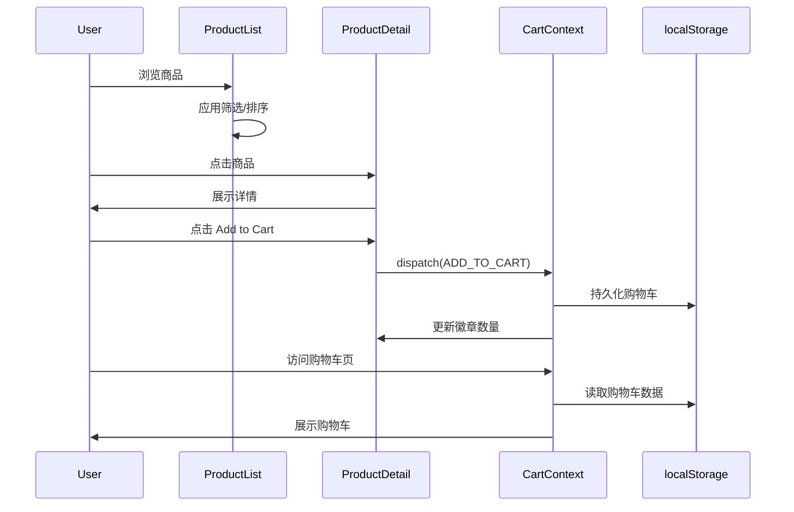
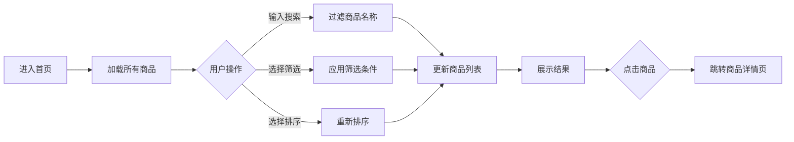
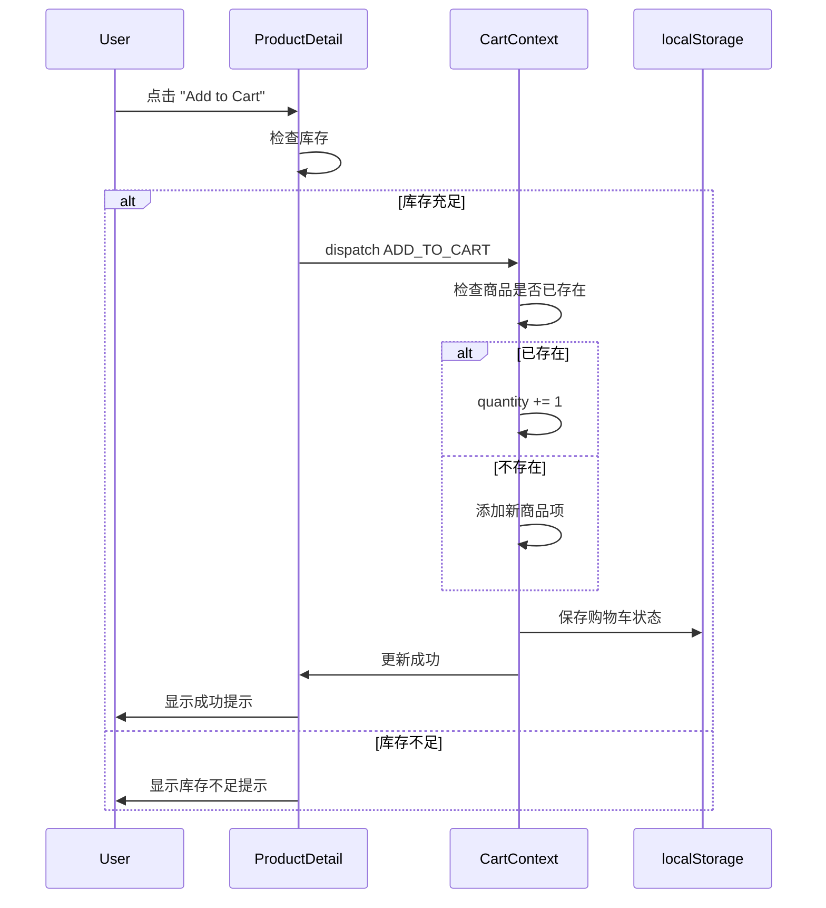
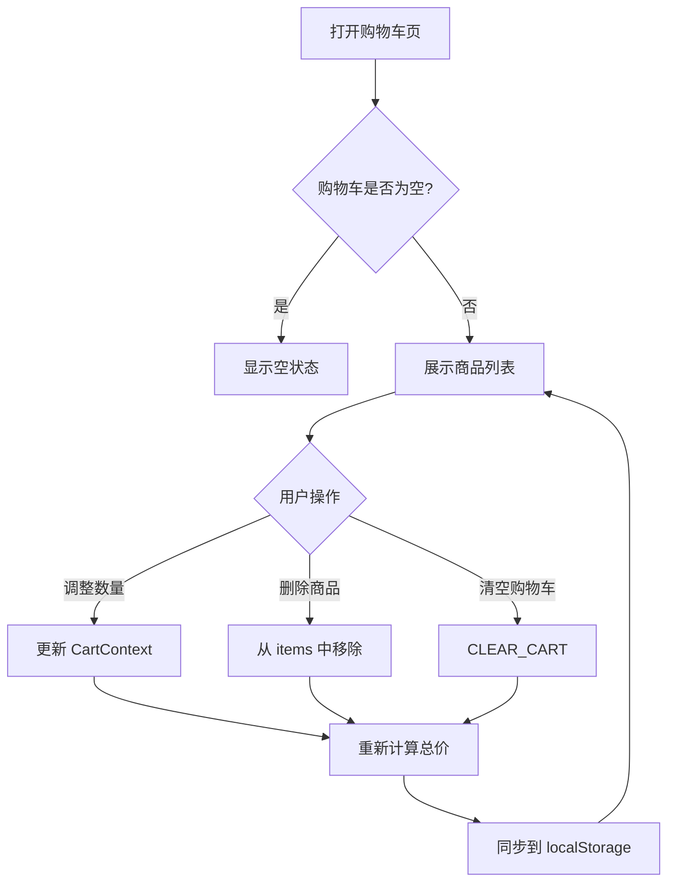

# 海外商品选购应用 设计文档

## 背景

开发一款面向海外消费者的商品选购应用，目标是提供流畅的商品浏览和购物车体验，达到可向客户演示的产品级质量。核心需求包括：
- 用户能够方便地浏览商品
- 支持搜索和多维度筛选
- 将商品添加到购物车并管理
- 在 PC 和移动设备上都有良好体验

预期效果：构建一个响应式的现代电商应用原型，使用 Mock 数据快速实现核心购物流程，为后续真实 API 集成预留清晰接口。

## 设计方案

### 核心思路

采用 **Vite + React + Tailwind CSS** 现代技术栈，实现三个核心页面（商品列表、商品详情、购物车）的完整购物流程。使用 Context API 管理购物车全局状态并通过 localStorage 持久化，确保刷新后数据不丢失。UI 采用深色主题 + 流式排版 + 完全圆角设计，提供精品电商级别的视觉体验。Mock 数据包含 20-30 个商品，覆盖多个品类和属性维度，满足筛选和排序演示需求。

### 技术架构图

```mermaid
graph TB
    subgraph "Presentation Layer"
        A[Pages]
        B[Components]
        C[Layout]
    end
    
    subgraph "State Management"
        D[CartContext]
        E[FilterState]
    end
    
    subgraph "Data Layer"
        F[Mock Data]
        G[localStorage]
    end
    
    A --> B
    A --> C
    B --> D
    B --> E
    D --> G
    E --> F
    
    style A fill:#161D2B
    style D fill:#0F131C
    style F fill:#0A0D12
```



### 数据流图



## 前端设计

### 一、技术栈选型

**核心框架与工具**
- **Vite 5.x**: 构建工具，提供极速开发服务器和优化构建
- **React 18**: UI 框架，使用函数组件 + Hooks
- **React Router v6**: 客户端路由
- **Tailwind CSS 3.x**: Utility-first CSS 框架
- **Headless UI**: 无样式可访问组件库（用于下拉菜单、对话框等交互组件）

**开发工具**
- ESLint + Prettier: 代码规范
- npm: 包管理器

### 二、页面结构与路由

**路由定义**
```javascript
/                    → HomePage (商品列表页)
/product/:id         → ProductDetailPage
/cart                → CartPage
```

**页面职责**
- `HomePage`: 展示商品网格、筛选侧边栏、搜索框、排序下拉菜单
- `ProductDetailPage`: 展示商品多图、详细信息、规格、评论、添加购物车按钮
- `CartPage`: 展示购物车商品列表、数量调整、删除、价格汇总

### 三、组件架构

#### 3.1 Layout 模块

**Header 组件**
```
Header
├── Logo (链接到首页)
├── SearchBar (搜索框，移动端可折叠)
└── CartIcon (购物车图标 + 商品数量徽章)
```

**Footer 组件**
- 版权信息
- 简单链接（可占位）

**Layout 组件**
- 包裹所有页面的容器
- 提供统一的 Header + Footer + 主内容区

#### 3.2 Product 模块

**ProductGrid 组件**
- 响应式网格布局（Desktop 3-4列，Tablet 2-3列，Mobile 1-2列）
- 接收商品数组和布局配置

**ProductCard 组件**
```javascript
Props: {
  product: ProductObject,
  onClick: () => void
}
Display:
- 商品缩略图
- 品牌和名称
- 价格（原价 + 折扣价）
- 评分星星 + 评论数
- 悬停效果（图片缩放、阴影）
```

**ProductDetail 组件**
```javascript
Props: {
  productId: string
}
Sections:
- 图片画廊（主图 + 缩略图切换）
- 商品基本信息（品牌、名称、价格、评分）
- 库存状态
- 商品描述和卖点列表
- "Add to Cart" 按钮
- 评论区域（简化展示）
```

**FilterSidebar 组件**
```javascript
Filter Sections:
1. 分类 (Category)
   - 复选框列表
2. 价格区间 (Price Range)
   - 预设区间选项（$0-$50, $50-$100, $100-$200, $200+）
3. 品牌 (Brand)
   - 复选框列表
4. 评分 (Rating)
   - 单选：4星以上、3星以上、全部

State Management:
- 使用 useState 管理筛选条件
- 通过回调函数传递筛选结果到父组件
```

**SearchBar 组件**
```javascript
Features:
- 实时搜索（输入时过滤）
- 清除按钮
- 移动端响应式（可折叠为图标）
```

**SortDropdown 组件**
```javascript
Sort Options:
- Price: Low to High
- Price: High to Low
- Rating: High to Low
- Newest
```

#### 3.3 Cart 模块

**CartContext（全局状态）**
```javascript
State: {
  items: CartItem[],
  totalItems: number,
  totalPrice: number
}

Actions:
- ADD_TO_CART
- REMOVE_FROM_CART
- UPDATE_QUANTITY
- CLEAR_CART

localStorage Integration:
- 每次状态更新自动同步到 localStorage
- 初始化时从 localStorage 读取
```

**CartIcon 组件**
```javascript
Display:
- 购物车图标
- 商品数量徽章（红色圆形，显示 totalItems）
- 点击跳转到 /cart
```

**CartItem 组件**
```javascript
Props: {
  item: CartItemObject,
  onUpdateQuantity: (productId, newQuantity) => void,
  onRemove: (productId) => void
}

Display:
- 商品缩略图
- 商品名称和品牌
- 单价
- 数量选择器（- / 数字 / +）
- 删除按钮
- 小计价格
```

**CartSummary 组件**
```javascript
Display:
- 商品总数
- 总价（USD）
- "Proceed to Checkout" 按钮（占位，点击显示提示）
```

### 四、数据结构设计

#### 4.1 商品数据结构（Product）
```typescript
interface Product {
  id: string;
  name: string;
  brand: string;
  price: number;
  originalPrice?: number;    // 原价，用于显示折扣
  currency: 'USD';
  images: string[];          // 多张图片 URL
  thumbnail: string;         // 列表缩略图
  category: string;          // 分类（Electronics, Clothing, Home, Beauty 等）
  rating: number;            // 0-5
  reviewCount: number;
  description: string;       // 详细描述
  features: string[];        // 卖点列表
  inStock: boolean;
  stockCount: number;
}
```

#### 4.2 购物车数据结构（Cart）
```typescript
interface CartItem {
  productId: string;
  product: Product;          // 完整商品信息
  quantity: number;
  addedAt: number;           // 时间戳
}

interface CartState {
  items: CartItem[];
  totalItems: number;        // 总件数
  totalPrice: number;        // 总价
}
```

#### 4.3 Mock 数据规划

**商品数量**: 20-30 个商品

**品类分布**:
- Electronics: 8 个商品
- Clothing: 7 个商品
- Home: 7 个商品
- Beauty: 8 个商品

**品牌分布**: 5-8 个虚构品牌

**价格分布**: $10 - $500，覆盖所有价格区间

**评分分布**: 3.5 - 5.0，确保筛选功能可演示

### 五、核心功能流程

#### 5.1 商品浏览流程


**实现细节**:
- 搜索: 实时过滤 `product.name.toLowerCase().includes(keyword)`
- 筛选: 多条件 AND 逻辑（分类 + 价格区间 + 品牌 + 评分）
- 排序: 使用 `Array.sort()` 按选定字段排序
- 所有操作在客户端完成，无需网络请求

#### 5.2 添加购物车流程


#### 5.3 购物车管理流程


### 六、响应式设计策略

#### 6.1 断点定义（Tailwind 默认）
```
sm: 640px   (小屏手机)
md: 768px   (平板竖屏)
lg: 1024px  (平板横屏 / 小笔记本)
xl: 1280px  (桌面)
2xl: 1536px (大屏桌面)
```

#### 6.2 布局适配方案

**Desktop (≥1024px)**
- Header: Logo 左对齐，SearchBar 居中，CartIcon 右对齐
- 商品列表: FilterSidebar 固定左侧（w-64），ProductGrid 3-4 列
- 购物车: 两栏布局（商品列表 + 侧边汇总）

**Tablet (768px - 1023px)**
- Header: 保持桌面布局，SearchBar 缩窄
- 商品列表: FilterSidebar 可折叠为按钮，ProductGrid 2-3 列
- 购物车: 单栏布局（汇总移到底部）

**Mobile (<768px)**
- Header: Logo 左对齐，SearchBar 折叠为图标，CartIcon 右对齐
- 商品列表: FilterSidebar 改为全屏抽屉，ProductGrid 1-2 列
- 购物车: 单栏布局，CartItem 紧凑排列

#### 6.3 Tailwind 响应式类使用示例
```jsx
// ProductGrid 响应式列数
<div className="grid grid-cols-1 sm:grid-cols-2 lg:grid-cols-3 xl:grid-cols-4 gap-6">

// FilterSidebar 响应式显示/隐藏
<aside className="hidden lg:block w-64">  {/* Desktop */}
<button className="lg:hidden">Filters</button>  {/* Mobile/Tablet */}
```

### 七、UI 设计规范

基于提供的 design_sense，应用以下视觉风格：

#### 7.1 配色方案
```css
/* 深色主题背景 - 五层阶梯 */
--surface-deep: #05070C;      /* 3% lightness */
--surface-base: #0A0D12;      /* 5% lightness */
--surface-raised: #0F131C;    /* 7% lightness */
--surface-elevated: #161D2B;  /* 10% lightness */
--surface-overlay: #1E2636;   /* 13% lightness */

/* 主色调 - 清新蓝绿 */
--accent-primary: #38BDF8;    /* 明亮青色 */
--accent-muted: #6EE7B7;      /* 柔和绿色 */

/* 文本颜色 */
--text-primary: #F8FAFC;      /* 高对比白色 */
--text-secondary: #94A3B8;    /* 中性灰 */
--text-tertiary: #64748B;     /* 弱化灰 */
```

#### 7.2 排版系统
```css
/* 字体族 - 使用 CSS 变量 */
--font-sans: system-ui, -apple-system, sans-serif;

/* 流式字号 - clamp() 实现响应式 */
--text-xs: clamp(0.75rem, 0.7rem + 0.25vw, 0.875rem);
--text-sm: clamp(0.875rem, 0.8rem + 0.375vw, 1rem);
--text-base: clamp(1rem, 0.9rem + 0.5vw, 1.125rem);
--text-lg: clamp(1.125rem, 1rem + 0.625vw, 1.25rem);
--text-xl: clamp(1.25rem, 1.1rem + 0.75vw, 1.5rem);
--text-2xl: clamp(1.5rem, 1.3rem + 1vw, 1.875rem);
--text-3xl: clamp(1.875rem, 1.6rem + 1.375vw, 2.25rem);

/* 行高 */
--leading-tight: 1.25;   /* 标题 */
--leading-normal: 1.5;   /* 正文 */
--leading-relaxed: 1.75; /* 长文本 */

/* 字间距 */
--tracking-tight: -0.025em;  /* 大标题 */
--tracking-normal: 0;        /* 正文 */
```

#### 7.3 布局与圆角
```css
/* 圆角 - 完全圆角设计 */
--radius-sm: 0.5rem;      /* 8px - 小元素 */
--radius-md: 1rem;        /* 16px - 卡片 */
--radius-lg: 1.5rem;      /* 24px - 大卡片 */
--radius-xl: 2rem;        /* 32px - 特大容器 */
--radius-full: 9999px;    /* 按钮、徽章 */
--radius-circle: 50%;     /* 头像、图标容器 */

/* 间距 Token - Tailwind 默认 */
space-2: 0.5rem
space-4: 1rem
space-6: 1.5rem
space-8: 2rem
space-12: 3rem
```

#### 7.4 组件样式示例

**按钮**
```jsx
// Primary Button
<button className="
  bg-[#38BDF8] text-white 
  px-6 py-3 rounded-full 
  font-medium tracking-tight
  hover:bg-[#0EA5E9] transition-colors
">
  Add to Cart
</button>

// Secondary Button
<button className="
  bg-[#161D2B] text-[#38BDF8] 
  px-6 py-3 rounded-full 
  border border-[#38BDF8]/30
  hover:bg-[#1E2636] transition-colors
">
  View Details
</button>
```

**商品卡片**
```jsx
<div className="
  bg-[#0F131C] rounded-2xl overflow-hidden
  hover:bg-[#161D2B] transition-colors
  group cursor-pointer
">
  
  <div className="p-4">
    <h3 className="text-[#F8FAFC] font-medium">Product Name</h3>
    <p className="text-[#38BDF8] text-lg font-semibold mt-2">$99.99</p>
  </div>
</div>
```

**徽章（购物车数量）**
```jsx
<span className="
  absolute -top-2 -right-2
  bg-[#38BDF8] text-white
  w-5 h-5 rounded-full
  flex items-center justify-center
  text-xs font-bold
">
  3
</span>
```

### 八、错误处理与边界情况

#### 8.1 商品加载失败
- **场景**: Mock 数据为空或加载失败
- **处理**: 显示空状态组件，文案 "No products available"

#### 8.2 搜索无结果
- **场景**: 用户搜索关键词无匹配商品
- **处理**: 显示 "No results found for '{keyword}'"，提供清除搜索按钮

#### 8.3 筛选无结果
- **场景**: 应用筛选条件后无商品
- **处理**: 显示 "No products match your filters"，提供重置筛选按钮

#### 8.4 购物车为空
- **场景**: 用户访问购物车页面但未添加商品
- **处理**: 显示空状态插图 + 文案 "Your cart is empty" + "Continue Shopping" 按钮

#### 8.5 库存不足
- **场景**: 用户尝试添加超出库存的商品数量
- **处理**: 
  - 添加购物车时检查 `product.stockCount`
  - 超出时显示 Toast 提示 "Only {stockCount} items available"
  - 购物车页面数量选择器禁用超出库存的数量

#### 8.6 localStorage 失败
- **场景**: 浏览器禁用 localStorage 或存储满
- **处理**: 
  - 使用 try-catch 包裹 localStorage 操作
  - 失败时降级为内存状态（刷新会丢失）
  - 显示警告提示用户启用 localStorage

### 九、性能优化策略

#### 9.1 图片优化
- 商品图片使用占位符服务（如 Unsplash, Placeholder.com）
- 缩略图和详情图分离，减少列表页加载体积
- 使用 `loading="lazy"` 懒加载图片

#### 9.2 组件优化
- ProductCard 使用 `React.memo` 避免不必要的重渲染
- 筛选和搜索使用 `debounce`（300ms）减少计算频率
- 购物车操作使用 `useCallback` 稳定函数引用

#### 9.3 代码分割
- 使用 React Router 的 `lazy` + `Suspense` 实现路由级代码分割
- ProductDetailPage 单独打包，减少首屏加载

## 影响范围

| 模块 | 是否改动 | 改动内容 |
|------|---------|---------|
| 项目初始化 | ✅ 新建 | Vite + React 项目脚手架 |
| 路由配置 | ✅ 新建 | React Router 路由定义 |
| 全局状态 | ✅ 新建 | CartContext + localStorage 集成 |
| Mock 数据 | ✅ 新建 | 20-30 个商品数据文件 |
| 页面组件 | ✅ 新建 | HomePage, ProductDetailPage, CartPage |
| UI 组件 | ✅ 新建 | 10+ 个可复用组件 |
| 样式配置 | ✅ 新建 | Tailwind 配置 + 自定义 CSS 变量 |

## 兼容性

### 浏览器支持
- **目标浏览器**: 现代浏览器最新两个版本
  - Chrome/Edge 90+
  - Firefox 88+
  - Safari 14+
- **移动浏览器**: iOS Safari 14+, Chrome Android 90+

### 响应式支持
- **桌面**: 1920×1080, 1366×768
- **平板**: iPad (768×1024), iPad Pro (1024×1366)
- **手机**: iPhone SE (375×667), iPhone 12 Pro (390×844), Android 中大屏

### 数据持久化
- localStorage 降级策略: 禁用时使用内存状态，提示用户

## 交付标准

### 功能完整性
- [ ] 商品列表页展示所有商品（响应式网格）
- [ ] 搜索功能正常（实时过滤）
- [ ] 筛选功能正常（分类、价格、品牌、评分）
- [ ] 排序功能正常（价格、评分）
- [ ] 商品详情页展示完整信息
- [ ] 添加购物车功能（含库存检查）
- [ ] 购物车页面增删改功能
- [ ] 价格计算正确
- [ ] localStorage 持久化生效

### 用户体验
- [ ] 页面加载流畅（无明显卡顿）
- [ ] 响应式适配完整（Desktop/Tablet/Mobile）
- [ ] 交互反馈及时（悬停、点击、加载状态）
- [ ] 空状态和错误提示友好
- [ ] 移动端触摸操作顺畅

### 代码质量
- [ ] 组件拆分合理，职责清晰
- [ ] 无 ESLint 错误
- [ ] 代码格式符合 Prettier 规范
- [ ] 无 console 警告/错误
- [ ] 关键逻辑有注释

### 演示就绪
- [ ] Mock 数据丰富且真实
- [ ] 视觉风格统一（深色主题 + 圆角设计）
- [ ] 可独立运行（npm run dev 即可启动）
- [ ] README 包含项目说明和启动步骤
